# Point of Sale & ERP Workstation 🛒

[](https://react.dev/)
[](https://www.typescriptlang.org/)
[](https://vitejs.dev/)
[](https://www.electronjs.org/)
[](https://www.sqlite.org/)
[](https://tailwindcss.com/)
[](https://microsoft.com)
[](#architecture)

An enterprise-grade, offline-first Desktop Point of Sale & Retail ERP Workstation engineered for high-velocity supermarkets, grocery stores, wholesale distributors, and retail businesses.

Built on **React 19**, **Vite**, **TypeScript**, **Electron**, and a zero-latency native **SQLite WAL** engine (`better-sqlite3`).

---

## 📸 System Showcase & Visual Walkthrough

### 1. Workstation Gateway & Role-Based Access Control
Single-window security gateway enforcing separate authenticated environments for Cashiers and Store Administrators with scrypt-salted hardware PIN security.

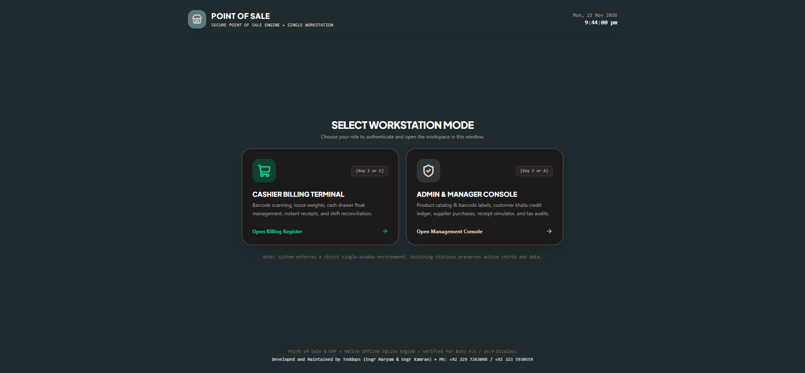

---

### 2. High-Speed Keyboard-Driven Cashier Terminal
Designed for rapid checkout lines with instant barcode scanning, single-key shortcuts, and 4 concurrent holding cart tabs for multi-customer line management.

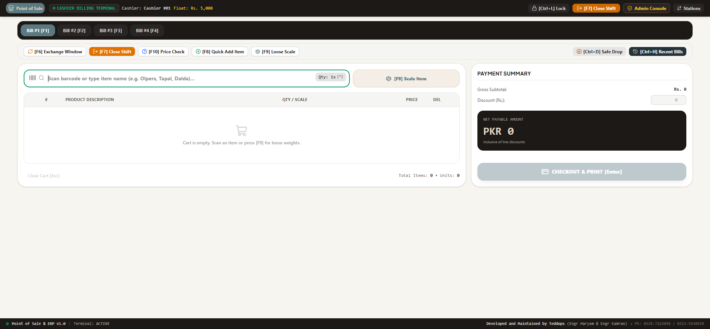

---

### 3. Loose Commodity & Dual-Unit Scale Terminal
Built-in calculator for bulk commodities (Atta, Rice, Sugar, Cooking Oil, Eggs). Automatically converts wholesale bulk packaging (e.g. 50kg bags, 30-egg trays) to retail fractions with both **Weight-first** and **Rupee-first** customer budget calculations.

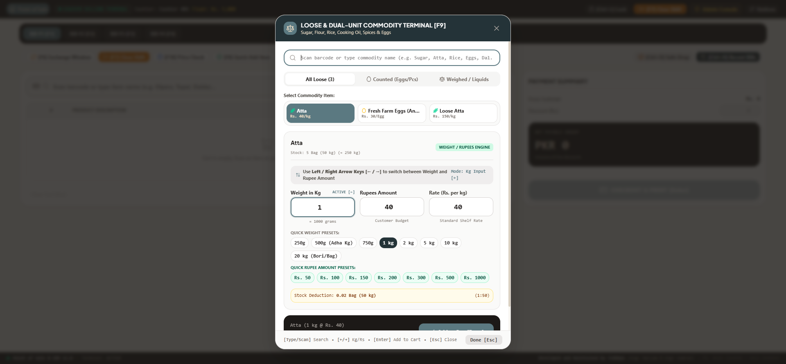

---

### 4. Live Multi-Currency Active Cart
Real-time line items with stock level alerts, instant quantity multipliers, and automatic nearest Rs. 5 Pakistan cash rounding.

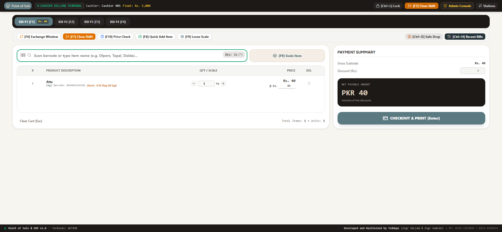

---

### 5. Multi-Channel Split Payment Modal
Split bills across Cash, Credit/Debit Card, Mobile Wallets (Raast, Easypaisa, JazzCash), and Customer Khata Credit Ledger with automatic change calculation and Amanat advance wallet offsetting.

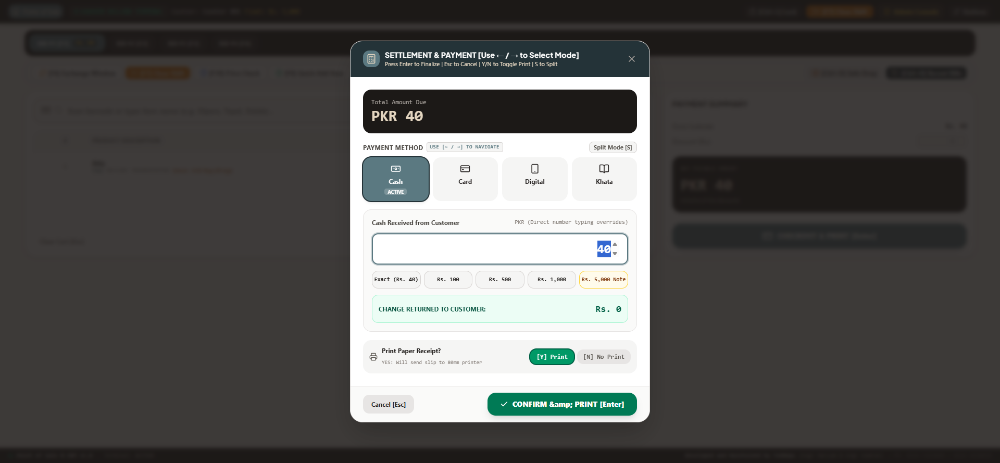

---

### 6. Product Catalog & Inventory Master
Inflation-resistant inventory management featuring weighted moving average cost accounting, dual-unit conversion setups, low stock thresholds, and single-click barcode sticker generation.

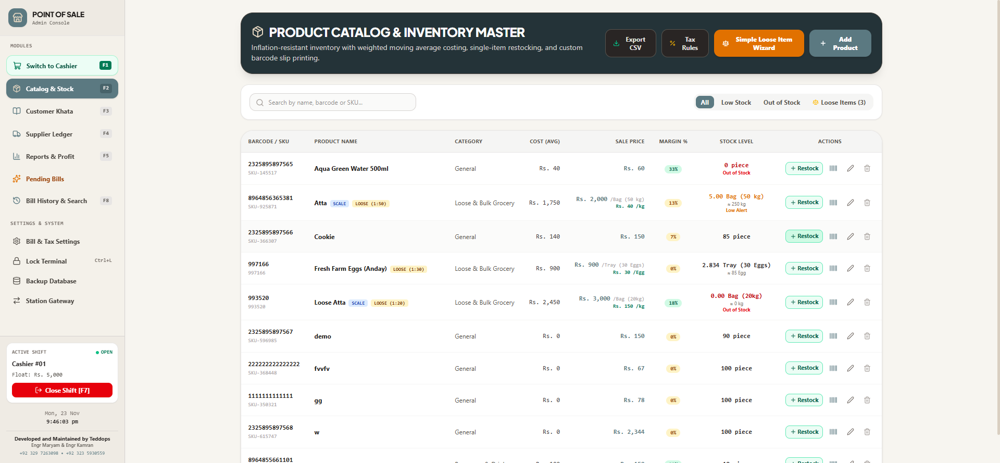

---

### 7. Mohalla Customer Khata & Amanat Sub-Ledger
Complete double-entry credit ledger with customer balance limits, 30-day debt aging indicators, dedicated advance deposit (Amanat) wallets, and 1-click WhatsApp PDF statements.

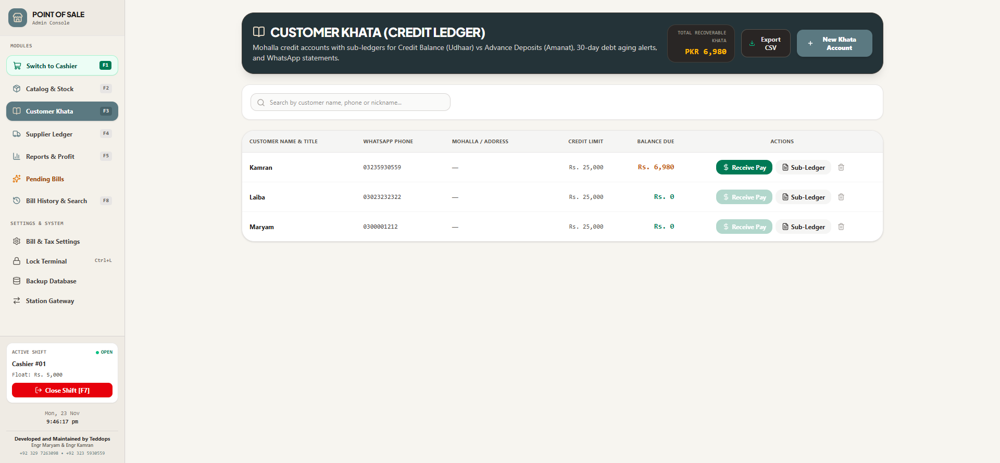

---

### 8. Supplier & Distributor Bahi-Khata Ledger
End-to-end procurement ledger supporting handwritten delivery slips (Katchi Parchi) vs official tax bills (Pakka Bill), Kasar (settlement discounts), wapsi/damage claims, and till cash deduction.

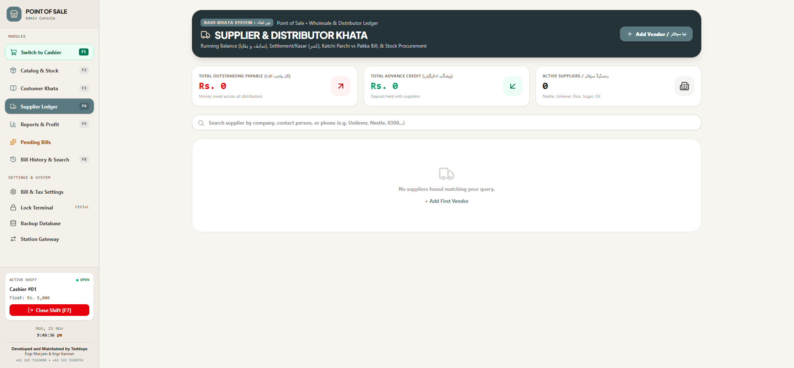

---

### 9. Financial Analytics, Profit Audits & Z-Report
Daily and monthly revenue breakdown, gross margin audits, category sales distributions, payment channel analytics, and blind shift close variance reports.

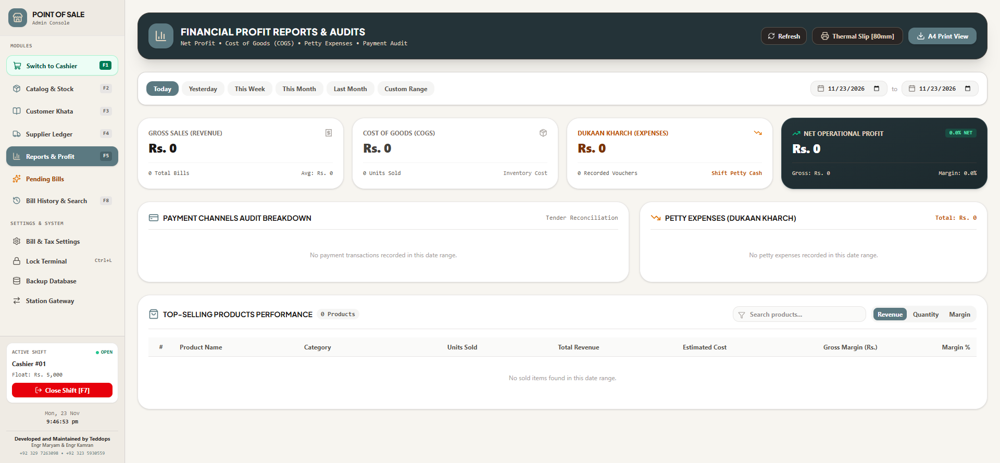

---

### 10. Bill History & Archival Thermal Reprint
Searchable historical bill ledger with pagination, cashier attribution, 1-click thermal receipt reprinting, and official A4 tax invoice generation.

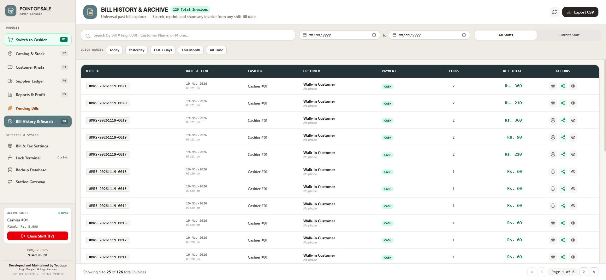

---

### 11. Custom Receipt Designer & Hardware Simulator
Live receipt preview customizer with configurable headers, Urdu Duas, return policies, barcode/QR print toggles, tax NTN options, and test thermal print triggers.

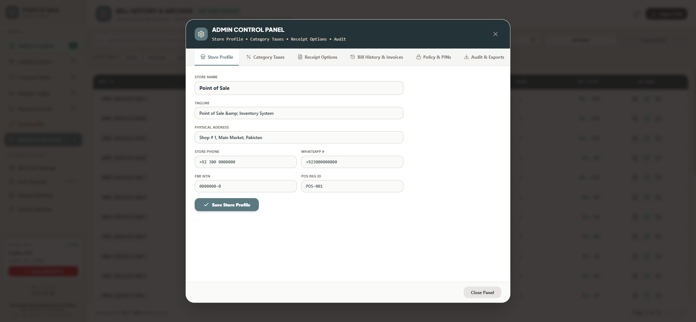

---

## ⚡ Core Capabilities

### 🛒 1. Cashier Billing Terminal
* **Keyboard-First Workflow**: Zero mouse dependency during rush hours.
* **Instant Barcode Matching**: Auto-focus scan buffer with instant dropdown closure upon scan.
* **4 Concurrent Cart Tabs (`F1` - `F4`)**: Put a customer's cart on hold without losing line progress when they fetch another item.
* **Pakistan Nearest Rs. 5 Rounding**: Strict compliance with physical Pakistani coin currency circulation.
* **Cash Drawer Float & Safe Drops**: Record opening float and skim excess cash from the drawer to the safe (`Ctrl+D`).

### ⚖️ 2. Dual-Unit & Loose Produce Engine
* **Loose Commodity Wizard**: Configure 50kg Bags to 1kg retail or 30-egg Trays to individual eggs.
* **Bidirectional Math**: Cashiers can type kilograms (e.g. 1.345 kg) or rupee budgets (e.g. "Rs. 200 worth of sugar").
* **Accurate Stock Deduction**: Deducts exact fractional bulk quantities from the warehouse inventory.

### 📒 3. Customer Khata & Amanat Wallet
* **Double-Entry Credit Ledger**: Auditable journal of every credit bill, repayment, and discount.
* **Advance Amanat Wallet**: Customers can deposit advance cash; auto-reconcile or preserve until harvest/payout.
* **WhatsApp Statements**: Direct formatted statement generation via WhatsApp Web/Desktop.

### 🚚 4. Supplier & Distributor Management
* **Katchi Parchi to Pakka Bill**: Track unverified handwritten delivery slips until reconciled against the final invoice.
* **Kasar (Settlement Discount)**: Automatically balances ledger discrepancies agreed with distributors.
* **Wapsi & Damage Returns**: Log damaged goods returned for credit notes.

### 🔒 5. Blind Shift Close Protocol
* **Anti-Theft Cash Drawer Count**: Cashiers enter note denominations blindly without seeing system expected cash.
* **Automated Variance Audit**: Instantly computes shortage or surplus variances logged to the permanent audit trail.

### 🖨️ 6. Hardware & Printing Integration
* **Thermal Receipt Printers**: Native ESC/POS printing for 80mm and 58mm thermal rolls.
* **Barcode Label Generator**: Dual-mode thermal sticker printing formatted for Xprinter XP-365B & multi-column A4 sticker sheets.
* **Cash Drawer Kick**: Hardware pulse trigger via thermal receipt printer port.

### 🖥️ 7. Low-Resolution Display Optimization
* Fully tested and optimized for **1366x768** and **1280x720** legacy POS hardware at **125% DPI scaling** so buttons and totals are never cut off by the Windows Taskbar.

---

## 🏗️ Architecture

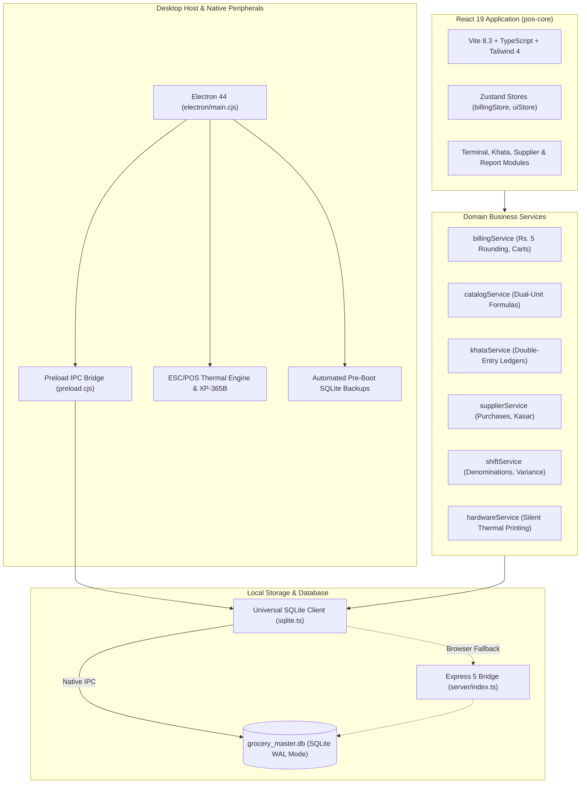

---

## ⌨️ Global Keyboard Shortcuts

| Shortcut | Description |
|---|---|
| `F1` - `F4` | Switch between 4 active billing cart tabs |
| `Enter` | Trigger checkout & payment modal / confirm dialog |
| `Esc` | Clear active cart / close open modals |
| `F6` | Returns, exchanges, and bill voiding |
| `F7` | Cashier shift blind close & drawer float count |
| `F8` | Quick add ad-hoc product to catalog & cart |
| `F9` | Open loose scale & dual-unit commodity terminal |
| `F10` | Quick price check modal |
| `Ctrl + D` | Safe drop cash drawer transfer |
| `Ctrl + H` | Recent bills and reprint archive |
| `Ctrl + L` | Lock terminal with PIN protection |
| `Numpad *` | Toggle quantity multiplier in scan bar |

---

## 🚀 Getting Started

### Prerequisites
* **Node.js**: v20 or higher
* **npm**: v10 or higher
* **OS**: Windows 10 or 11 (64-bit)

### Installation
```bash
# Clone the repository
git clone https://github.com/kamranahmed0611/pos-product.git
cd pos-product

# Install dependencies
npm install
```

### Running in Development
```bash
# Start full desktop application (Electron + Server + Vite)
npm start

# Run Vite web preview only
npm run dev
```

### Verification & Testing
```bash
# Run 100% comprehensive unit, math, and database integrity test suite
npm test
```

### Building the Windows Installer
```bash
# Produces production-ready Windows NSIS Setup .exe in release/
npm run electron:build
```

---

## 📁 Project Structure

```
POS_Product/
├── electron/
│   ├── main.cjs               # Electron lifecycle, silent thermal print & IPC handlers
│   └── preload.cjs            # Secure contextBridge API definition
├── pos-core/
│   ├── index.html             # Vite single-page application entry
│   ├── vite.config.mts        # Modern Vite ESM configuration
│   ├── test_pos_core.ts       # 100% comprehensive business logic test suite
│   └── src/
│       ├── App.tsx            # Root application router & station mode manager
│       ├── components/
│       │   ├── billing/       # Billing terminal, split payments, loose weights
│       │   ├── catalog/       # Product catalog, barcode sticker generator
│       │   ├── khata/         # Customer ledger & Amanat advance deposits
│       │   ├── suppliers/     # Supplier Bahi-Khata & procurement
│       │   ├── shifts/        # Blind shift close & drawer float count
│       │   ├── history/       # Bill search & reprint archive
│       │   ├── emergency/     # Backdated bills & high-density receipt cards
│       │   ├── reports/       # Financial reports, Z-reports, profit audits
│       │   └── common/        # PIN screens, gateways, error boundaries
│       ├── db/
│       │   ├── schema.ts      # Master SQLite table schema & safe migrations
│       │   └── sqlite.ts      # Dual-mode native Electron IPC / HTTP client
│       ├── services/          # Pure business logic services
│       ├── store/             # Zustand state management stores
│       └── types/             # TypeScript domain entity interfaces
├── server/
│   └── index.ts               # Express 5 SQLite bridge for browser dev mode
├── docs/
│   ├── screenshots/           # High-resolution application screenshots
│   └── *.md                   # Architecture & hardware specifications
└── package.json               # Scripts, dependencies & electron-builder metadata
```

---

## 🔒 Security & Data Integrity

1. **Scrypt-Salted PIN Hashing**: All cashier and admin authorization PINs are hashed using Node.js `crypto.scryptSync` with unique cryptographic salts (`N=16384, r=8, p=1, keylen=64`).
2. **Atomic SQLite Transactions**: Inventory decrements and double-entry ledger entries execute inside native SQLite `db.transaction()` blocks to prevent partial balance distortions during power cuts.
3. **Pre-Boot Automated Backups**: Before launching the database engine, the application creates a timestamped pre-boot snapshot in `POS_Backups/` to safeguard against unexpected OS crashes.

---

## 📄 License & Attribution

Developed and maintained by **Teddops** (Engr Maryam & Engr Kamran).  
Hotlines: `+92 329 7263098` • `+92 323 5930559`
