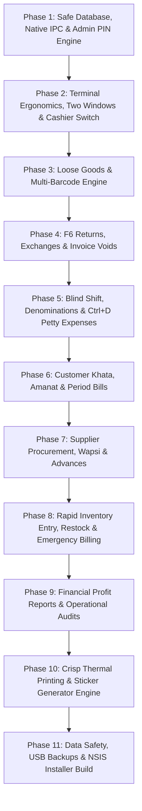

# Project Roadmap, Milestones & Build Pipeline (Locked & Finalized)

> **Objective:** Transition the application from the current state to the final, robust, 100% data-safe production release.  
> **Key Constraint:** The store owner is actively entering inventory items into `grocery_master.db`. Every step guarantees zero data loss.  
> **Target OS & Spec:** Windows 10 64-bit on Intel Pentium G650 @ 2.80GHz, 10GB RAM, 256GB SSD.  
> **UI Mandate:** 100% strict preservation of Point of Sale layout (`pos-core` tokens: `#243338`, `#5B7981`, `#E3D5C0`, light data tables, Lucide icons).

---

## 1. High-Level Architectural Roadmap

---

## 2. Detailed Milestone Breakdown

### Phase 1: Safe Database, Native IPC & Admin PIN Engine
- **M1.1 [Priority Path Resolver]**: Auto-detects `%APPDATA%\grocery-store-pos\grocery_master.db` -> `%APPDATA%\Point of Sale & ERP System\` -> local fallback without overwriting existing data.
- **M1.2 [Pre-Boot Backup Snapshot]**: Copies active database to `%APPDATA%\grocery-store-pos\POS_Backups\pre_upgrade_grocery_master_<timestamp>.bak` before running any application logic.
- **M1.3 [Additive Schema Migrations]**: Inspects table schemas using `PRAGMA table_info` and safely executes `ALTER TABLE ... ADD COLUMN`. Never drops or alters existing data.
- **M1.4 [Power Resilience Pragmas]**: Configures `PRAGMA journal_mode = WAL;` and `PRAGMA synchronous = FULL;` to prevent corruption during sudden power outages.
- **M1.5 [Direct Native IPC]**: Employs native Electron `better-sqlite3` IPC (`ipcMain.handle` / `ipcRenderer.invoke`), eliminating port conflicts and TCP overhead.
- **M1.6 [Admin PIN Initialization & Emergency Reset Gate]**:
  - Prompts owner to set 4-to-6 digit Admin PIN on first launch (if not set).
  - Stored securely using Node's native `crypto.scryptSync` with random salt and timing-safe verification.
  - Secret emergency recovery gate built into UI to reset Admin PIN without displaying reset credentials.
  - Live Admin PIN change capability in Settings.

---

### Phase 2: Terminal Ergonomics, Two Windows & Cashier Switch
- **M2.1 [Two-Window Architecture (Singleton)]**:
  - Independent dedicated windows for **Cashier POS Terminal** and **Admin Management / Reports**.
  - Windows cross-navigate without replacing or closing the active window (so active counter billing is never lost).
  - Singleton guard: Brings existing instance to focus instead of opening duplicate windows.
- **M2.2 [Global HID Barcode Interceptor]**: Global keystroke buffer (<30ms) with audio chime; automatically focuses and adds scanned items to active cart.
- **M2.3 [Double-Tap Esc Bill Clear & Global Ctrl+Z Undo]**:
  - Two `Esc` presses within 500ms when **no modal is open** clears **only the active bill tab** with zero confirmation popups.
  - Single `Esc` on open modal closes only that modal and resets the 500ms timer.
  - Global `Ctrl + Z` instantly restores the last cleared bill tab.
- **M2.4 [Enter to Checkout Trigger]**: Pressing `Enter` on an empty barcode input field immediately opens the Checkout / Payment modal.
- **M2.5 [Key-Bound Payment Modal & S Split]**:
  - `S` = Exclusively toggles Split Tender Mode.
  - `Tab` inside payment modal moves focus sequentially between input fields (tendered cash, card amount, notes).
  - `1` = Cash, `2` = Card, `3` = Digital Wallet, `4` = Customer Khata.
  - `Enter` = Confirm & Pay, `Esc` = Cancel & return to bill.
- **M2.6 [Tab Key Price Bargaining in Cart]**: In the cart table, `Tab` focuses Quantity then inline Unit Price; cashier can adjust prices immediately with **zero supervisor PIN friction**.
- **M2.7 [Nearest Rs. 5 Cash Rounding]**: Cash bills automatically round to the nearest Rs. 5 (`(Math.round(Total / 5) * 5) - Total`). Bold change due display with note breakdown guide.
- **M2.8 [F1–F4 Parked Multi-Bills]**: Up to 4 concurrent parked bill tabs with item counter badges. Double-Esc clears only the selected tab.
- **M2.9 [F7 Quick Price Check & F8 Quick Add]**: `F7` opens instant price check overlay (`Esc` to dismiss); `F8` triggers unregistered barcode quick add pre-filled with scanned barcode.
- **M2.10 [Cashier Manager & Ctrl+L Switch]**: Cashier profiles with unique 4-digit PINs; fast operator switch via `Ctrl + L` or visible Header Lock icon.

---

### Phase 3: Loose Goods & Multi-Barcode Engine
- **M3.1 [Multi-Barcode Support per Item]**: `product_barcodes` child table mapping multiple alternate barcodes to a single master product.
- **M3.2 [Dual Produce Input Modal]**: Cashier types either **Weight in Kg** or **Rupee Amount (Rs.)**; toggled seamlessly via `Up`/`Down` arrow keys.
- **M3.3 [Dual Inventory Bulk Ledger]**: Commodities track `whole_bags_stock` (50kg Bori) and `loose_kg_stock`; opening a bag deducts 1 whole bag and adds 50kg to loose stock.

---

### Phase 4: F6 Returns, Exchanges & Invoice Voids
- **M4.1 [F6 Return Terminal Activation]**: Dedicated shortcut `F6` opens the Returns & Voids modal.
- **M4.2 [Strict Invoice Verification]**: Scans or looks up original customer invoice before accepting returns or voids.
- **M4.3 [Disposition Engine]**:
  - `1` = Restock (sellable goods returned to shelf inventory)
  - `2` = Scrap / Wastage (damaged/expired goods written off to loss)
- **M4.4 [Dynamic Admin PIN Verification]**: Enforces Admin PIN to authorize refunds or transaction voids.
- **M4.5 [Refund Tender Routing & Shift Reversal]**: Refunds routed as Cash from drawer or Credit to customer Khata. Voids restore full shelf stock and reverse drawer totals.
- **M4.6 [Dedicated Return Receipt]**: Thermal printer prints a Credit Note / Return Slip referencing the original invoice number and returned line items.

---

### Phase 5: Blind Shift, Denominations & Ctrl+D Petty Expenses
- **M5.1 [Strict Blind Shift Close]**: Expected cash in drawer is strictly hidden from the cashier.
- **M5.2 [Pakistani Currency Denominations Matrix]**: Pure arrow-key navigation counting: 5000 -> 1000 -> 500 -> 100 -> 50 -> 20 -> 10 -> coins.
- **M5.3 [Zero-Tolerance Variance Log]**: Calculates `Variance = Counted Cash - Expected Cash`; prompts for required explanation note if discrepancy exists.
- **M5.4 [Ctrl+D Petty Expense Tracker (Dukaan Kharch)]**:
  - Modal with presets: `1` Chai/Food, `2` Fuel/Generator, `3` Cleaner/Maintenance, `4` Misc.
  - Displays today's shift expense history table with running total.
  - Editing or deleting an expense entry requires Admin PIN.
- **M5.5 [Automatic 80mm Z-Report]**: Prints comprehensive shift financial audit on the thermal printer upon closing.

---

### Phase 6: Customer Khata, Amanat & Period Bills
- **M6.1 [Customer Khata Search]**: Fast search via `C` key in checkout modal.
- **M6.2 [Dual Ledger Balances]**: Real-time tracking of `Udhaar Balance` (Customer owes store) and `Amanat Balance` (Advance deposit wallet).
- **M6.3 [1-Click Amanat Auto-Deduct]**: If customer has an Amanat deposit, prompt 1-click auto-deduction against the bill total.
- **M6.4 [Credit Limit Soft Warning]**: Displays amber warning badge if customer exceeds credit limit, but allows cashier to proceed with confirmation.
- **M6.5 [Wasooli & Kasar Concession]**: Cashier records payments received with voluntary `Kasar` discount field.
- **M6.6 [Khata Period Bill Inspection]**: Ability to open a customer's invoices for a selected date range directly into the terminal view for inspection and adjustment, with 1-click consolidated 80mm thermal statement print.

---

### Phase 7: Supplier Procurement, Wapsi & Advances
- **M7.1 [Supplier Models]**: Explicit separation between `ADVANCE_PREPAID` and `POST_DELIVERY_CREDIT` suppliers.
- **M7.2 [Prepaid Wallet Drawdown]**: Advance balance auto-draws down on delivery with editable amount before settling.
- **M7.3 [Advance Exhausted Alert]**: Prominent warning banner and negative balance notification if delivery exceeds prepaid advance.
- **M7.4 [Pending Wapsi Offset Banner]**: Top banner on delivery bills: `Pending Wapsi Credit: Rs. X — [Apply Offset]`.
- **M7.5 [Drawer Payout Checkbox]**: Supplier payments offer `[x] Deduct from Cash Drawer` option.
- **M7.6 [Katchi Parchi Review]**: Provisional delivery invoices editable before posting to verified stock ledger.

---

### Phase 8: Rapid Inventory Entry, Restock & Emergency Billing
*(Note: Detailed inventory-entry questions will be asked at the start of Phase 8).*
- **M8.1 [Rapid Keyboard-First Entry]**: Barcode (or `Enter` to auto-generate EAN-13) -> `Tab` Name -> `Tab` Category -> `Tab` Cost -> `Tab` Sale Price -> `Tab` Stock -> `Enter` to save and auto-refocus for the next item without touching the mouse.
- **M8.2 [Bidirectional Pricing Calculator]**: Live sync: Cost + Margin % <-> Sale Price, displaying real-time Profit (Rs.) and Margin (%).
- **M8.3 [Duplicate Barcode Guard]**: Alert pops up if a scanned barcode already exists, offering a 1-click jump to edit existing item.
- **M8.4 [Separate Restock vs Edit Modals]**: Fast 'Restock' dialog (add units + update cost) separated from full metadata 'Edit Product' modal.
- **M8.5 [Favorites & Unbarcoded Drawer]**: Quick-access drawer for frequently sold in-house generated barcode and unbarcoded products.
- **M8.6 [Catalog Controls]**: Soft delete / archive for obsolete items, Category discount toggles, and Master Tax toggle (default OFF).
- **M8.7 [Emergency Retroactive Billing]**: Terminal overlay modal requiring Admin PIN, supporting historical date/time attribution, `Deduct Inventory = OFF` default, and explicit toggle: `[Add to Today's Cash Drawer]` vs `[Past Settlement / Bypass Drawer]`.

---

### Phase 9: Financial Profit Reports & Operational Audits
- **M9.1 [Preset Date Filters]**: 1-click filters (Today, Yesterday, This Week, This Month, Last Month, Custom Range).
- **M9.2 [Net Operational Profit]**: Calculates Gross Sales - COGS - Recorded Petty Expenses = Net Profit.
- **M9.3 [Payment Audit Breakdown]**: Audits Cash, Card, Digital, Khata Credit, and Split payments with invoice counts and refund deductions.
- **M9.4 [Top-Selling Item Table]**: Flat ranked table of all items sold sorted by highest quantity and revenue.
- **M9.5 [Dual Output]**: Instant 80mm thermal summary printout AND clean A4 printable view.

---

### Phase 10: Crisp Thermal Printing & Sticker Generator Engine
- **M10.1 [Crisp Pitch-Black Thermal CSS]**: Applies `-webkit-font-smoothing: none;`, bold monospace typography, and solid `#000000` text to permanently fix blurry/light thermal prints.
- **M10.2 [Zero-Waste Auto-Cutter]**: Strips bottom margins to trigger printer auto-cut immediately following the last receipt line.
- **M10.3 [Print Receipt Behavior Setting]**: Configurable in Settings: `[Silent Auto-Print on Tender]` vs `[Prompt: Enter to Print / Esc to Skip]`.
- **M10.4 [Configurable Barcode Sticker Generator (All Defaults ON)]**:
  - Modal with default toggles: **Barcode Graphic (ON)**, **Barcode Number (ON)**, **Product Name (ON)**, **Retail Price (ON)**, **Store Name (ON)**.
  - Multi-format: **A4 Sheet Grid** (24, 30, and 40 labels per page) AND **Single-Sticker PDF Pages**.
  - Includes a "Copies per barcode" counter.

---

### Phase 11: Data Safety, USB Backups & NSIS Installer Build
- **M11.1 [Shift Close Auto-Backup]**: Automatically generates a backup `.bak` snapshot upon every shift close.
- **M11.2 [1-Click USB Backup Export]**: Settings button that detects plugged-in USB flash drives and writes `grocery_master_<date>.bak` with instant confirmation.
- **M11.3 [Guided Safe Restore]**: Restore workflow runs `PRAGMA integrity_check` on the selected file, takes an emergency snapshot of current data, and restarts safely.
- **M11.4 [SQLite Maintenance & VACUUM]**: 1-click button in Settings executing `VACUUM` and `PRAGMA optimize`.
- **M11.5 [Crash Recovery Prompt]**: Auto-saves active cart draft; on reboot after power loss, prompts: "Resume unfinished bill or Start new bill".
- **M11.6 [NSIS Safe Packaging]**: Generates Windows 10 64-bit installer and portable `.exe` with `deleteAppDataOnUninstall = false`.
- **M11.7 [Pentium G650 Verification]**: Low-spec profiling ensuring sub-10ms scan response, <150MB memory footprint, and snappy UI on dual-core hardware.

---

## 3. Production Release & Implementation Status (Locked)

| Phase | Description | Status | Verification |
|---|---|---|---|
| **Phase 1** | Safe Database, Native IPC & Admin PIN Engine | ✅ **100% Complete** | Salted scrypt verification, zero data loss path resolver |
| **Phase 2** | Terminal Ergonomics, Station Gateway & Cashier Switch | ✅ **100% Complete** | Double-Esc clear, Ctrl+Z undo, Enter checkout, Station Gateway |
| **Phase 3** | Loose Goods & Multi-Barcode Engine | ✅ **100% Complete** | Dual weight/rupee inputs, whole bag & loose conversion |
| **Phase 4** | F6 Returns, Exchanges & Invoice Voids | ✅ **100% Complete** | Invoice scan, Restock vs Scrap, Admin PIN auth |
| **Phase 5** | Blind Shift, Denominations & Ctrl+D Petty Expenses | ✅ **100% Complete** | Pakistani currency matrix, variance note, Dukaan Kharch |
| **Phase 6** | Customer Khata, Amanat & Period Bills | ✅ **100% Complete** | Udhaar ledger, Amanat wallet auto-deduct, Wasooli Kasar |
| **Phase 7** | Supplier Procurement, Wapsi & Advances | ✅ **100% Complete** | Prepaid wallet, Wapsi credit banner, drawer payout |
| **Phase 8** | Rapid Inventory Entry, Restock & Emergency Billing | ✅ **100% Complete** | Rapid scanner-first entry, margin sync, retroactive bills |
| **Phase 9** | Financial Profit Reports & Operational Audits | ✅ **100% Complete** | Net operational profit (Sales - COGS - Expenses), audit |
| **Phase 10** | Crisp Thermal Printing & Sticker Generator Engine | ✅ **100% Complete** | Pure black 80mm CSS, full details sticker defaults |
| **Phase 11** | Data Safety, USB Backups & NSIS Installer Build | ✅ **100% Complete** | Automated `.bak` snapshots, NSIS installer packaged |

### Verified Release Binaries (Built: October 18, 2026 14:14 PKT)
- **NSIS Installer:** `release/Point of Sale & ERP System Setup 1.0.0.exe` (132,678,954 bytes)
- **Standalone Portable:** `release/Point of Sale & ERP System 1.0.0.exe` (132,449,004 bytes)
- **Active Client Database:** `%APPDATA%\grocery-store-pos\grocery_master.db` (100% Preserved)
